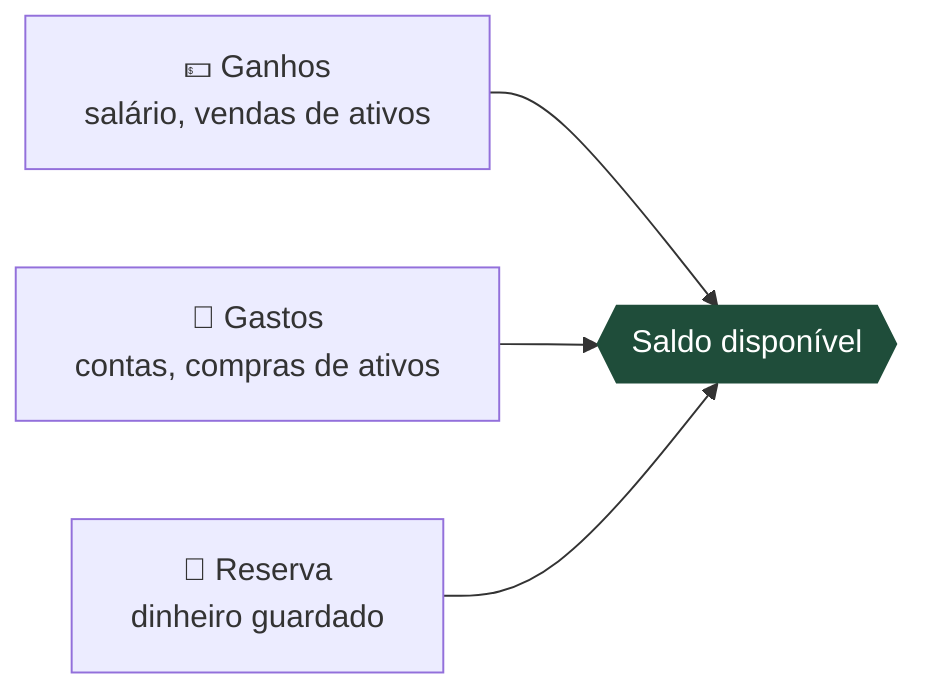
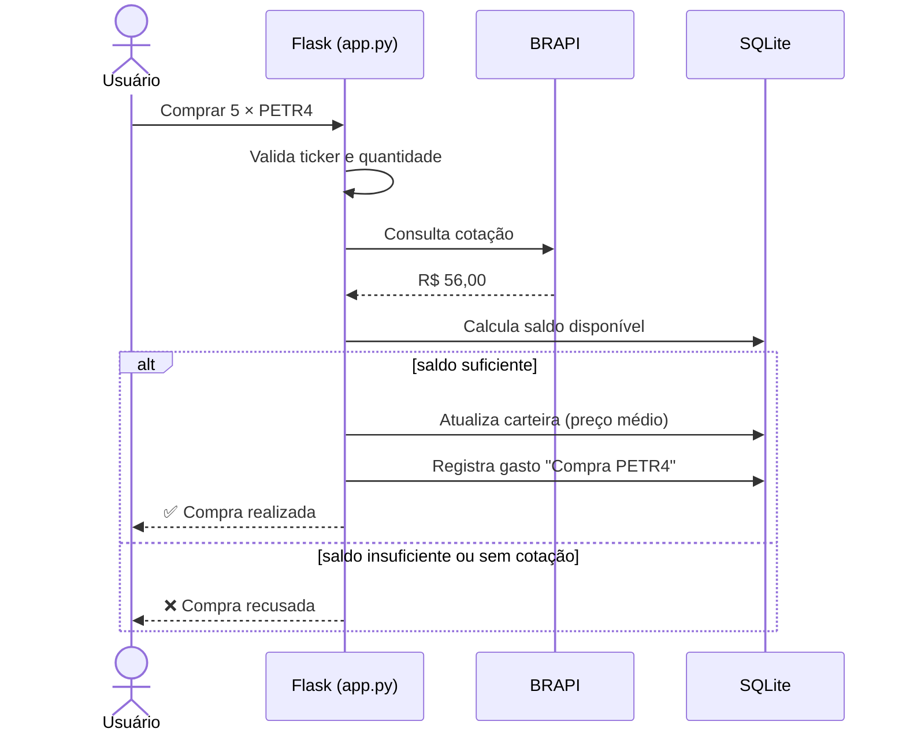
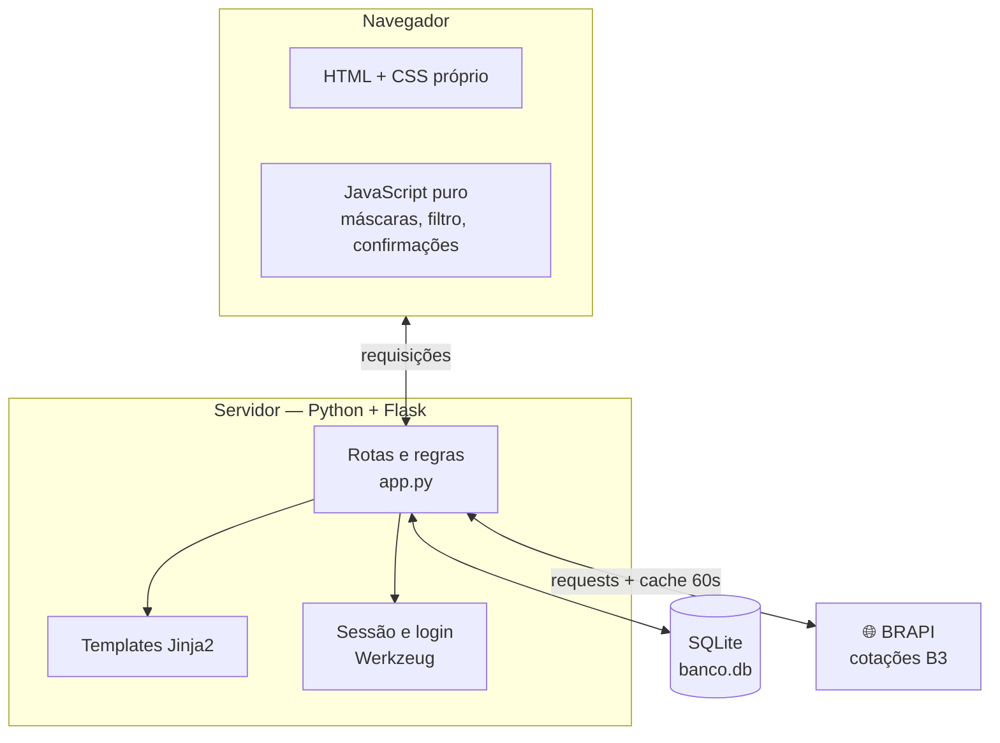
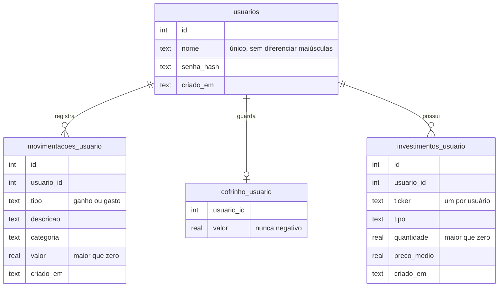

<div align="center">

# 💰 FinanceApp

**Controle financeiro pessoal com carteira de investimentos e cotação real da B3**

Registre ganhos e gastos, separe uma reserva e acompanhe suas ações e FIIs com preço atualizado da bolsa brasileira.


-D97757?style=flat-square)

[Funcionalidades](#-funcionalidades) •
[Como funciona](#-como-funciona) •
[Arquitetura](#-arquitetura) •
[Segurança](#-segurança) •
[Como rodar](#-como-rodar) •
[Roadmap](#-roadmap)

</div>

---

## 🧮 A ideia central

Tudo no sistema gira em torno de uma conta simples, mostrada no topo do painel:

<div align="center">

### `Ganhos − Gastos − Reserva = Saldo disponível`

</div>

Cada ação altera um desses quatro números, e **nenhum total é guardado pronto**: o sistema recalcula tudo a partir das movimentações sempre que a página abre.



> **Exemplo dos testes:** ganhos de R$ 5.450,00, gastos de R$ 1.837,90 e reserva de R$ 650,00 dão saldo de **R$ 2.962,10**. Comprar 5 ações a R$ 61,20 registra um gasto de R$ 306,00 e o saldo cai para **R$ 2.656,10**.

---

## ✨ Funcionalidades

| Área | O que dá para fazer |
|---|---|
| 👤 **Conta** | Criar conta, entrar, sair, trocar nome de usuário e senha |
| 📊 **Painel** | Ver ganhos, gastos, reserva e saldo, com barra de proporção em três cores |
| 📝 **Movimentações** | Registrar ganho ou gasto, filtrar (Todas / Ganhos / Gastos) e excluir |
| 🐷 **Reserva** | Guardar parte do saldo e retirar quando precisar |
| 📈 **Investimentos** | Pesquisar ações e FIIs, comprar, vender e ver lucro ou prejuízo |

<details>
<summary><b>Ver detalhes de cada área</b></summary>

### 👤 Conta
- Nome de usuário de 3 a 30 caracteres e senha com no mínimo 8.
- Login mantido por até 31 dias, ou até clicar em **Sair**.
- Trocar a senha exige a senha atual.

### 📝 Movimentações
- Cada registro tem tipo, descrição, categoria e valor; a data é gravada automaticamente.
- Lista da mais recente para a mais antiga.
- O campo de categoria sugere as já usadas e algumas comuns (Alimentação, Moradia, Transporte).
- Excluir pede confirmação e recalcula o saldo.

### 🐷 Reserva
- **Guardar** tira do saldo e soma na reserva (recusa se for maior que o saldo).
- **Retirar** faz o caminho inverso (recusa se for maior que o guardado).

### 📈 Investimentos
- Pesquisa por ticker ou nome, com preço atual e botão **Usar na compra**.
- **Comprar** usa a cotação do momento e registra um gasto `Compra TICKER`.
- **Vender** usa a cotação do momento e registra um ganho `Venda TICKER`.
- A carteira mostra quantidade, preço médio, preço atual, valor atual e resultado em R$ e %.
- Cotações da [BRAPI](https://brapi.dev), serviço de dados da bolsa brasileira.

</details>

---

## ⚙️ Como funciona

### Fluxo de uma compra de ativo



### Regras de cálculo

| Número | Fórmula |
|---|---|
| Ganhos | Soma das movimentações do tipo ganho (inclui vendas) |
| Gastos | Soma das movimentações do tipo gasto (inclui compras) |
| Saldo disponível | `Ganhos − Gastos − Reserva` |
| Preço médio | `(qtd antiga × PM antigo + qtd nova × preço) ÷ qtd total` |
| Resultado do ativo | `qtd × preço atual − qtd × preço médio` |
| Rentabilidade | `resultado total ÷ valor pago × 100` |

**Três regras protegem a conta:**
1. 🚫 Compra recusada se custar mais que o saldo disponível.
2. 🚫 Venda recusada se a quantidade for maior que a que você tem.
3. 🚫 Sem cotação, sem compra nem venda. A carteira mostra o preço médio no lugar.

---

## 🏗️ Arquitetura



### Banco de dados



Apagar um usuário apaga em cascata tudo que é dele.

### Estrutura de pastas

```
FinanceApp/
├── app.py                  # servidor: banco, login, finanças, investimentos, erros
├── requirements.txt        # dependências para rodar
├── requirements-dev.txt    # dependências para testar (pytest)
├── .env.example            # modelo das variáveis de ambiente
├── .gitignore              # mantém .env e banco.db fora do Git
├── README.md
├── templates/
│   ├── base.html           # moldura: menu lateral, fontes
│   ├── _mensagens.html     # avisos de sucesso e erro
│   ├── index.html          # painel
│   ├── investimentos.html  # carteira, compra e pesquisa
│   ├── perfil.html
│   ├── login.html
│   ├── cadastro.html
│   ├── 404.html
│   └── 500.html
├── static/
│   ├── css/style.css
│   └── js/script.js
└── tests/
    ├── conftest.py             # banco temporário e BRAPI simulada
    ├── test_valores.py         # valores, quantidades e tickers inválidos
    ├── test_saldo.py           # cálculo do saldo
    ├── test_reserva.py         # guardar e retirar
    ├── test_investimentos.py   # compra, venda, preço médio e carteira
    ├── test_isolamento.py      # um usuário não acessa dados de outro
    └── test_paginas.py         # páginas, login e proteção das rotas
```

### Rotas

| Rota | Método | Função |
|---|---|---|
| `/cadastro` | GET, POST | Cria a conta |
| `/login` | GET, POST | Entra |
| `/logout` | POST | Sai |
| `/perfil` | GET, POST | Troca nome ou senha |
| `/` | GET | Painel |
| `/adicionar` | POST | Registra ganho ou gasto |
| `/excluir/<id>` | POST | Exclui movimentação |
| `/cofrinho` | POST | Guarda na reserva |
| `/retirar_cofrinho` | POST | Retira da reserva |
| `/investimentos` | GET | Carteira e pesquisa |
| `/investimentos/adicionar` | POST | Compra pelo formulário |
| `/investimentos/comprar` | POST | Compra mais de um ativo da carteira |
| `/investimentos/vender` | POST | Vende |
| `/investimentos/excluir/<id>` | POST | Remove ativo da carteira |

Todas as rotas, exceto cadastro e login, exigem estar logado.

---

## 🔒 Segurança

| Proteção | Como funciona |
|---|---|
| 🔑 Senhas | Nunca gravadas em texto; o banco guarda só o hash |
| 🍪 Sessão | Cookie assinado, `HttpOnly` e `SameSite=Lax` |
| 🧱 Isolamento | Toda consulta e exclusão confere o dono do registro |
| 💉 SQL Injection | Consultas parametrizadas, sem montar SQL com texto do usuário |
| ⏱️ Enumeração de usuários | Login gasta o mesmo tempo quando o usuário não existe |
| 🏷️ Ticker | Só aceita 2 a 12 letras e números antes de chamar a BRAPI |
| 🤫 Segredos | Chave da sessão e token da BRAPI no `.env`, fora do Git |

**Validações de valores:** só números maiores que zero e até R$ 999.999.999,99; `NaN` e `Infinity` recusados; leitura no padrão brasileiro (`1.500,00`); descrição até 100 caracteres e categoria até 50; resposta inesperada da BRAPI tratada como "sem cotação".

---

## 🎨 Interface

- Visual claro com fundo cinza-esverdeado, cartões brancos e bloco verde-escuro de destaque.
- Menu lateral fixo que vira barra no topo no celular.
- **Máscara de valor:** digite `150000` e aparece `1.500,00`. Colar `R$ 2.345,67` também funciona.
- Enter no campo de quantidade da carteira não envia nada, para evitar compra por engano.
- Avisos de sucesso somem em 4,5 s; avisos de erro ficam na tela.
- Layout testado de **360 px a 1920 px** sem estouro de largura.
- Fontes **Bricolage Grotesque** (títulos e números) e **Figtree** (texto).

---

## 🚀 Como rodar

**Pré-requisito:** Python 3 instalado.

```bash
# 1. Clone o repositório
git clone https://github.com/lorenzomarcal/FinanceApp.git
cd FinanceApp

# 2. (Opcional) Crie um ambiente virtual
python -m venv venv
venv\Scripts\activate        # Windows
source venv/bin/activate     # Linux/macOS

# 3. Instale as dependências
pip install -r requirements.txt

# 4. Crie o .env a partir do modelo e preencha
cp .env.example .env

# 5. Rode
python app.py
```

Abra **http://127.0.0.1:5000** e crie sua conta. O `banco.db` é criado sozinho na primeira execução.

### Variáveis de ambiente

| Variável | Para quê |
|---|---|
| `SECRET_KEY` | Sequência longa e aleatória que assina o login |
| `BRAPI_TOKEN` | Token gratuito de [brapi.dev](https://brapi.dev). Sem ele o app funciona, mas sem cotações |
| `FLASK_DEBUG` | `1` só durante o desenvolvimento |

> 💡 Para gerar uma `SECRET_KEY`: `python -c "import secrets; print(secrets.token_hex(32))"`

---

## 🧪 Testes

### Testes automáticos

O projeto tem **224 testes automáticos** com [pytest](https://docs.pytest.org), na pasta `tests/`:

| Arquivo | Testes | O que confere |
|---|:---:|---|
| `test_valores.py` | 102 | `NaN`, `Infinity`, zero, negativo e acima de R$ 999.999.999,99 recusados em movimentações e reserva; leitura no padrão brasileiro; quantidade e ticker inválidos |
| `test_saldo.py` | 9 | `Ganhos − Gastos − Reserva = Saldo`, exclusão de movimentação, centavos sem erro de arredondamento |
| `test_reserva.py` | 10 | Guardar e retirar, com recusa acima do saldo ou do valor guardado |
| `test_investimentos.py` | 41 | Compra e venda, recusa por saldo ou quantidade insuficiente e por falta de cotação, preço médio, resultado da carteira |
| `test_isolamento.py` | 16 | Um usuário não vê, exclui, vende nem usa o que é de outro; exclusão em cascata |
| `test_paginas.py` | 46 | Todas as páginas carregam, rotas protegidas exigem login, cadastro, login e troca de senha |

Para rodar:

```bash
pip install -r requirements-dev.txt
pytest
```

Os testes usam um banco temporário e cotações da BRAPI simuladas: o `banco.db` real não é tocado e nenhuma chamada sai para a internet.

### Testes manuais

| Teste | Resultado |
|---|---|
| Jornada completa no navegador | ✅ Saldos conferidos à mão |
| Máscara de valor (digitando e colando) | ✅ |
| Larguras de 360 a 1920 px | ✅ Sem estouro |
| Cotação real na BRAPI | ✅ PETR4 a R$ 56,00 em 10/10/2026 |

---

## 🗺️ Roadmap

- [x] `requirements.txt` e testes automáticos dentro do projeto
- [ ] Token CSRF em todos os formulários
- [ ] Limite de tentativas de login
- [ ] Gravar valores em centavos inteiros
- [ ] Ligar a movimentação "Compra X" ao ativo da carteira
- [ ] Decidir o que acontece ao remover um ativo (devolver o pago ou vender a mercado)
- [ ] Editar movimentação, filtro por mês e gráfico por categoria
- [ ] Migrar para PostgreSQL
- [ ] Empacotar com Docker
- [ ] Servidor de produção (Gunicorn ou Waitress) e deploy

---

## 🤖 Sobre o desenvolvimento

Este projeto foi desenvolvido por mim com o **auxílio do Claude, uma inteligência artificial da Anthropic**. Usei a IA como parceira de estudo e programação: para tirar dúvidas, revisar código, encontrar e corrigir falhas de validação e segurança, escrever testes e documentar o sistema.

As decisões sobre o que construir, os testes de uso e a revisão final foram feitos por mim, como parte da minha trilha de estudos em desenvolvimento back-end.

---

<div align="center">

Feito por **Lorenzo Marçal** · [GitHub](https://github.com/lorenzomarcal)

⭐ Se este projeto te ajudou de alguma forma, deixa uma estrela!

</div>
